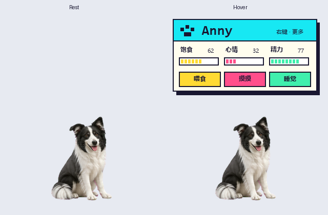

# Anny Desktop Pet

Anny 的 Windows / macOS 独立桌宠。离线运行，无需 Codex 或账号。



## Windows 使用

从 [Releases](../../releases) 下载便携包，解压后双击 `AnnyDesktop.exe`，保留同目录的 `assets` 文件夹。需要 Windows 和 .NET Framework 4.x。

- 平时只显示狗狗；悬停显示像素风姓名、状态和互动卡片，移开自动收起。
- 拖动狗狗移动位置，单击摸摸；右键菜单和托盘提供更多操作。
- 喂食连续吃四口（约 3.2 秒），饱食度增加一次；支持睡觉与唤醒。
- 自主走动、十六方向注视和多组动作；睡眠帧对齐中心及落地点。
- 逐像素透明窗口，保留毛发透明边缘。

饱食、心情、精力保存在 `%LOCALAPPDATA%\AnnyDesktop\state.txt`。位置、菜单偏好和睡眠状态不保存。退出旧版后再启动新版，同一时间只运行一个实例。

## macOS 使用

从 [Releases](https://github.com/Doodle-Lin/anny-desktop-pet/releases) 下载 `macos-universal.zip`，解压后把 `Anny.app` 拖到“应用程序”并打开。支持 Apple Silicon 和 Intel；构建最低目标为 macOS 11，自动检查使用 macOS 15。

macOS 版本使用原生 AppKit，无需 .NET、Python、Node 或 Codex。功能包括拖动、透明区域点击穿透、悬停像素卡片、四口喂食、睡眠定位、十六方向注视和自主走动。菜单栏的 🐾 可操作所有动作，也可“找回 Anny”或退出。右键或 Control + 单击打开菜单。

此版本仅有 ad-hoc 签名，尚未使用 Apple Developer ID 签名和公证。首次下载可能被 Gatekeeper 阻止：先尝试打开，再到“系统设置 → 隐私与安全性”中允许打开此应用。无需关闭系统安全功能。

macOS 存档独立保存在 `~/Library/Application Support/AnnyDesktop/state.json`，每 30 秒和退出时保存。无需辅助功能或屏幕录制权限。系统全屏和受保护窗口的置顶效果由 macOS 决定。

素材位于 `Anny.app/Contents/Resources/assets`。推荐修改仓库中的 `assets` 后重新构建，以保持签名有效。

### macOS 构建与检查

在安装 Xcode Command Line Tools 的 Mac 上执行：

```bash
bash macos/build.sh
dist/Anny.app/Contents/MacOS/Anny --smoke-test
```

产物为 `dist/Anny.app` 和 Universal ZIP。脚本分别编译 arm64 / x86_64，合并后进行 ad-hoc 签名。检查使用独立临时存档，截图和结果写入 `qa-macos`，不会修改个人存档。GitHub Actions 在 Apple Silicon 和 Intel macOS 15 上分别构建并运行检查；桌面多屏拖动等体验仍需实机人工确认。

## Windows 构建与检查

在 Windows PowerShell 中执行：

```powershell
.\build.ps1
$p = Start-Process .\AnnyDesktop.exe -ArgumentList '--smoke-test' -Wait -PassThru
if ($p.ExitCode -ne 0) { throw 'Smoke test failed' }
Get-Content .\qa\result.txt
```

使用 Windows 自带的 .NET Framework C# 编译器，无需安装 NuGet 依赖。检查使用临时存档，覆盖动作、透明渲染、移动、悬停面板、喂食循环和睡眠定位；检查结果输出到 `qa/`。

## 替换素材

`assets/pet.png` 是 8 列 × 13 行的透明 PNG 图集，每格 192 × 208。`assets/pet.ini` 配置动作行号、有效帧数、播放速度和移动速度，修改后重启。

行号从 0 开始：0 待机，1 向右走，2 向左走，3 挥爪，4 跳跃，5 受挫，6 等待，7 思考，8 观察，9–10 十六方向注视，11 吃饭，12 睡觉。注视行固定为 9–10。睡觉会根据不透明像素边界对齐待机中心和基线；替换素材时应保持一致画布、比例及干净透明背景。

计时器约 16ms，但原画每组为 4–8 帧，刷新率不等于原画帧率。可选帧间柔化默认关闭，开启可能有重影。

详细操作见 [使用说明](使用说明.txt)。
